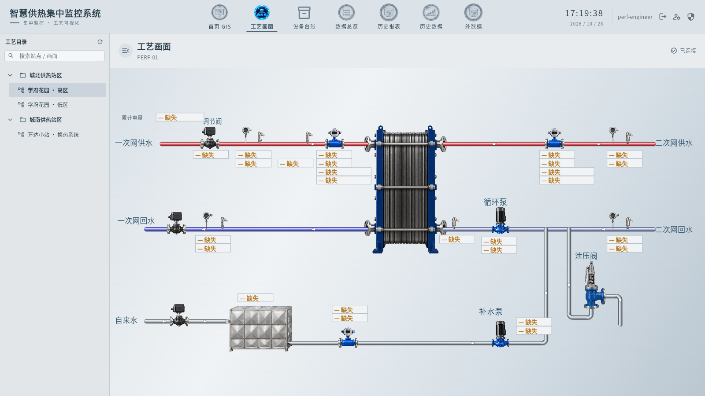
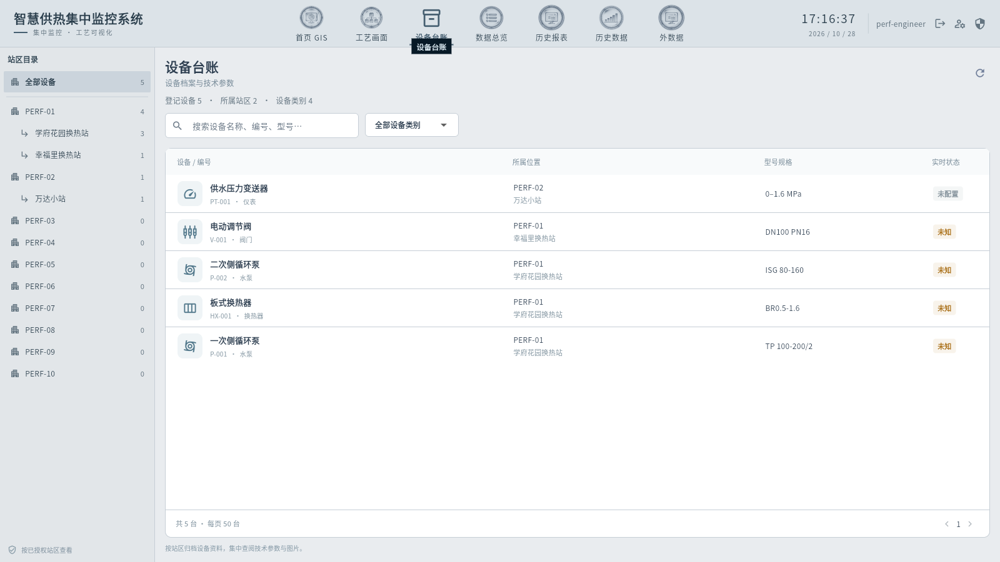
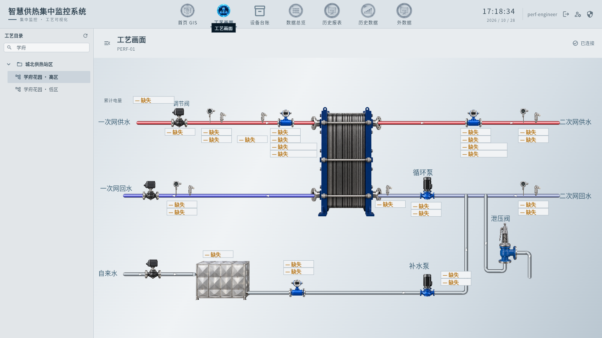

# 普通运行区背景、顶部与紧凑目录

2026-10-28。需求母本：[agent.md](../../agent.md)，视觉规范：[design.md](design.md)。

仅修改Flutter展示层：普通页顶部选中图标恢复原彩色、去选中底块、保留下划线。目录强调色收敛为石墨灰，只突出当前画面。内置供热模板的运行展示增加静态钢灰渐变，贯穿整个视口；文档、绑定、管线、图片和修订号不改写，自定义背景和开发编辑器保持。

按后续反馈将工艺、站点范围、设备站区和外数据目录统一为紧凑PC侧栏：宽248px、标题38px、搜索32px、目录行32–34px，细分隔与小圆角。运行工艺选中项变化不再触发目录重读，普通页面间切换保留工艺树和搜索；显式刷新仍有效。实现位于shared/desktop_sidebar.dart、process/monitor.dart、screen_explorer.dart、page_navigation.dart及equipment/external_data的展示组件，无新增Go业务接口。

## 通过项与发布

Go全量test/vet通过。最终Flutter analyze无问题、215项测试通过；包括目录选择不重载、普通页面间保留同一树和搜索的回归。Windows与Web release均实际编译，并通过组合包来源/文件摘要校验。编译来源摘要为`f71bf43201bce198f9f6d85bb8c40a74f796f8f326a3ed17009b4cb9d3bbb175`。

隔离Chrome使用同一Web产物与只读测试工程，1600×900逐页查看工艺、台账、总览、报表、历史、外数据；850×600目录抽屉检查通过。12次跨站/同站切图保持同一搜索元素与位置，无`navigation`或`all=true`目录请求；画布自身读取对应站点/文档属正常加载。真实点击搜索框并键入“学府”，切至报表后返回，搜索文字与筛选结果保留。此前未聚焦的直接DOM fill及只读inputValue探针不能代表Flutter的实际编辑状态，原日志保留；最终以聚焦键入和截图核验。没有把测试工程的缺失数据当作正常数据，未写入原工程。

固定18153已更新为`dist/Universal-HMI-ProcessSurface-20261028-v2`，PID71016，桌面运行态/开发态快捷方式继续通过同一project.json读取新版。备份`.local/postgres/backups/20261028-171155-process-surface`；原PG11表数量/逻辑摘要全部一致，保留1账号、4站点、3文档和12条审计，无新增登录。原用户浏览器未刷新。

本任务不修改GIS。封存包逐字复制当时已部署MoonRender版本的5204个GIS文件，完整文件清单摘要`75d0be529bceb8061d846dcd26745abd5b15b835b0eefdb68b2b11c3e90c3a34`；overlay来源单独记录在包清单，未将其宣称为此次Flutter编译结果。未操作GIS浏览器控制或镜头；旧共享测试会话状态变化后改用独立desktop-ui-final会话完成普通页检查。

首次组合检查曾因共享构建目录的旧GIS脚本拒绝，后续串行构建/封存校验已通过；旧15:48版ProcessSurface未部署，最终为上述v2。部署后健康、认证会话、本机5位密码策略、服务返回main.dart.js/bootstrap/GIS入口摘要均通过。完整数据摘要与来源见[部署记录](evidence/20261028-process-surface/deployment.json)，日志和截图在同目录。

当前Git基点f552d81。通过GitHub连接重新核对旧CI38031925059的10个job均success；该历史CI不覆盖本工作树。GitHub匿名API受到限流，使用已连接GitHub只读查询完成核查。

本批没有制作新安装EXE。原生鼠标、DPI、多屏、目标现场及真实设备仍未在本批验收，不以Web截图或构建成功替代。

