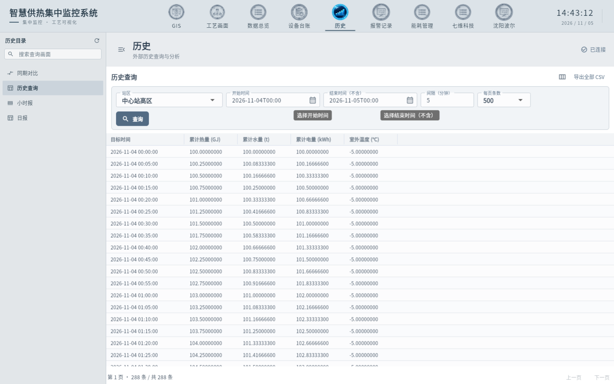
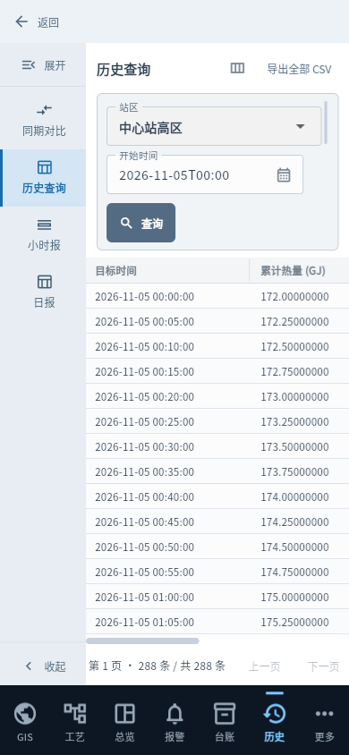
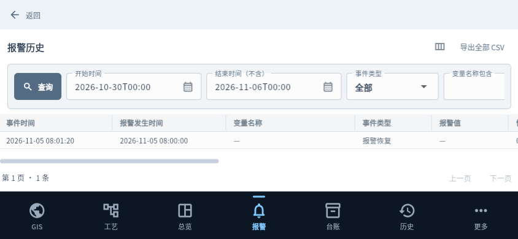

# 查询区与普通页面视觉统一 v43

产品母本为 [agent.md](../../agent.md)，分层见 [architecture.md](architecture.md)，状态见 [唯一看板](../../AI_BOARD.md)。

## 本批范围

Flutter 展示层统一历史查询、报警、小时报、日报、能耗、同期对比、总览、设备台账、设备审批与开发端历史筛选。`shared/query_toolbar.dart` 限制可见条件行数并固定主要操作；窄屏额外条件在页内滚动，极矮区域采用单行横向条件和固定主操作。正常查询区最多三行，短窗口按完整行减少高度。公共主题统一控件边框、白色输入底、浅灰查询底、间距和标题操作对齐；安卓横屏同样保持44逻辑像素控件。审批表单保留44像素目标。

原左侧目录、选择状态与简洁底部主导航保留。查询仍调用原公开API；本批不修改后端业务、SQL语义、变量身份归属、权限、设备批准或存储契约。未纳入已有的PICX工具及output未提交改动。

## 验证记录

v42文档head `7676841` 的 Verify [41964197738](https://github.com/YufeiSun5/universal-hmi/actions/runs/41964197738) 最终失败，原因为安卓总览测试使用无时区时间字符串后假设北京时间。本批将合成样本明确为 `+08:00`，保留13:07:10显示断言；未改生产时间转换。

Go实际执行工具链为1.27.3（Go1.24.7入口根据go.mod自动选择），全量test/vet通过。Flutter3.35.4全量584项通过、2项既有浏览器专用跳过；静态分析、249文件只读格式检查通过。最后显示边框和细滚动条调整后，完整584项/2跳过、analyze和249文件格式门禁再次通过。

实际Chrome在隔离SQL Server2017工程验证普通历史288行查询、同期对比汇总与曲线；台账、总览和审批使用隔离合成配置。小时报、日报、能耗及报警的填充布局使用HTTP响应夹具，明确仅验证显示与操作，不作为本批真实统计过程验收。最终无缓存WebAssembly在1440×900、900×600、390×844、844×390检查；日历选日期、输入、搜索/清除、来源筛选、目录收放与条件滚动通过，页面未捕获运行异常。25张最终截图及对应边界见[QA清单](evidence/20261105-v43/qa.json)和[发行清单](evidence/20261105-v43/release.json)。Web截图不替代原生DPI或安卓真机。

最终包横屏复查发现：844×390报警页虽未超过三行，仍挤占数据区。已在公共查询栏中增加低于500逻辑像素窗口的单行模式：主查询固定，其他操作和条件横向滚动，保持44像素触控区。19项查询/报表专项及22项历史滚动回归通过。完整测试首次复跑中4项旧用例未滚回“清除”按钮，出现点击窗外警告；补充滚动到操作与可见性断言，保留原清空结果断言，不忽略点击失败。最终完整复跑585项通过、2项既有跳过，249文件格式检查通过，analyze无问题。

中间候选Web构建曾报告成功，但实际横屏页面仍为旧布局。核查发现`main.dart.wasm`仍是14:24的旧文件，日志含无效`dart2wasm.d`缓存提示；浏览器下载摘要与磁盘一致，排除仅浏览器缓存。已隔离本地`app/.dart_tool/flutter_build`及两份旧候选，重新构建并以实际画面和文件摘要复核。中间构建不算最终通过；后续本机发行遇到同类提示必须清理已确认的生成缓存并复查，不能只依据源文件清单或命令退出码宣称已包含变更。

## 最终产物与保数据验收

最终产品提交`31c35a99f677a36127bc407f88775625160d7c82`，应用源摘要`ecab3118dfc96072bdd3254d93ec306931fe16eddfe21dee5a120f73a719ee92`。Windows/Web同源release和最终包清单核验通过；最终WASM摘要`0d48b32974ff2c09acc6b10ef466c77e1b0a865fe789208cc6e06db524168c45`，已实际确认横屏修正生效。安卓15项单元测试、lint/release、5,740项内置Web资源与固定服务器身份核对通过；签名证书继续为`97247b52d1b26718619999c4c7fd4b308b8f50418079b954ba1e6faa132cf80c`。

完整包在`dist/installers/full-20261105-v43/`，同时逐文件核对后复制到`C:/Users/SunYufei/Downloads/`：

| 文件 | 字节数 | SHA-256 |
| --- | ---: | --- |
| Universal-HMI-20261105-Full-v43-Setup.exe | 235282114 | e9898fcd70675f332d593d01bcd02b7c7aba2f714673ee1bc9b317a93b295136 |
| Universal-HMI-Android-v43.apk | 127638808 | 3a2e9246a22c5a8447be348a143e475cbebcfaa276edfd737b1a1043f58fbe6d |

同目录有中文安装说明和SHA256文件。Windows安装器未签名，WebView2保持原独立前置依赖。本轮旧候选包已隔离，不作为交付。

v42→v43使用真实PostgreSQL的独立工程副本验证：覆盖安装、新版后台启动和账号登录、同版重装、卸载均通过；5,019变量、31画面、12张表摘要、来源/绑定/导航、设备配置/图片、设备登记及批准证书保持。安装、重装、卸载均不修改工程文件，不执行重建；测试端口停止、安装登记移除、原快捷方式恢复。证据见发行清单中的`upgrade`和[升级日志](evidence/20261105-v43/upgrade.log)、[清理日志](evidence/20261105-v43/cleanup.log)。临时浏览器、只属于本轮的SQL库/登录及两个QA后端均清理。

产品提交的[Linux生命周期41981337011](https://github.com/YufeiSun5/universal-hmi/actions/runs/41981337011)成功；[跨平台Verify41981337039](https://github.com/YufeiSun5/universal-hmi/actions/runs/41981337039)交付记录时仍在运行，Go三平台和Android已成功，不能写成最终全部通过。[PR57](https://github.com/YufeiSun5/universal-hmi/pull/57)叠加PR56，保持草稿；后续文档head的CI须单独核对。

现场、18153和用户原工程未修改；安卓真机覆盖、Windows原生DPI/多屏及现场数据未验。

## 实际界面示例

